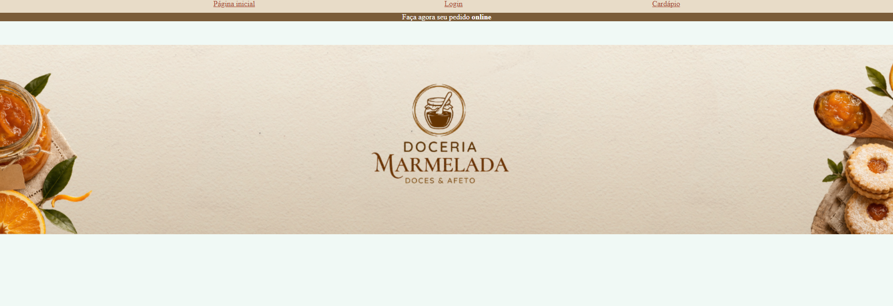
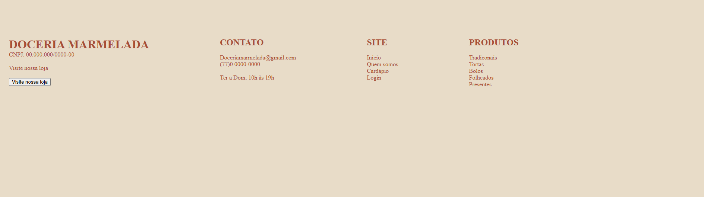

## Doceria Marmelada 
 
 Integrante: Lara Gabrielle  
Curso: Informática para internet - IFTP SESI 2D  
Professor: Josué Evangelista  

## Apresentação do projeto 

**O que é o projeto?**  
A doceria Marmelada é uma vitrine virtual (e-commerce) criada para trazer um ambiente aconchegante e acolhedor para os consumidores. 

**Qual principal objetivo?**  
O objetivo do site é ser intuitivo e prático, de modo que torne a experiência de compra do consumidor mais rápida e fácil, usando os conceitos de usabilidade para projetar um site que ajuda na rotina e possa ser acessado rapidamente em qualquer momento.

**Qual problema busca resolver?**  
O site da doceria Marmelada parte do cenário onde existe a loja física, sendo esse o único meio de compra. Analisando a partir desse ponto, surge a necessidade de trazer uma plataforma virtual para facilitar a compra sem precisar do deslocamento, além de ser um meio que facilita o contato e conhecer o estabelecimento antes da loja presencial.

**Por que esse projeto foi desenvolvido?**  
Para prototipagem do projeto surgiu o desafio de criar uma plataforma inteira do 0. A escolha de uma doceria vinha da ideia de que um local podia passar a percepção de algo aconchegante. As escolhas, desde a paleta de cores até a definição de combos e presentes, abrangem os conceitos para ornar com o nome e a ideia que o site quer passar.   

## Funcionalidades
- Navegação pela página inicial (Home)
- Sistema de identificação ( Login )
- Catálogo digital e catalogação de produtos 
- Rodapé e canais de contato (Footer)

## Tecnologias ultilizadas 
- HTML
- CSS

## Estrutura
1. Pasta geral ( projetoSite) - contém todos os arquivos que compõem o site.  

2. Arquivo inicio.html - Página destinada para os código de HMTL e CSS da página inicial do site. 

3.  Arquivo login.html -  Página destinada para os código de HMTL e CSS da página de cadastro 

4. Arquivo cadapio.html -  Página destinada para os código de HMTL e CSS da página que contém os alimentos disponíveis para venda - o catálogo. 

5. Imagens - Pasta separadas para imagens que não carregavam o endereço de imagem

## Como executar?
Primeiramente, confira se o navegador está com a extensão *Live Server* instalada. Após a instalação, basta clicar com o botão direito em cima do arquivo e selecionar a opção *“Open with Live Server”* e o site será aberto no navegador. 

## Demonstração
Confira abaixo a prévia do que você vai encontrar em nosso site.

**Página inicial**  
---
Página onde o usuário conhece o site, contendo a identidade visual e informações necessárias para um primeiro acesso. Além disso, contém os botões e sessões para que seja possível ir para qualquer outra página.

.png)
.png)
.png)
.png)

**Página login**
---
Área destinada à identificação dos usuários. Possui campos para preenchimento de e-mail e senha, além das opções de login e cadastro. Sua finalidade é permitir que os clientes acessem ou criem suas contas na plataforma, para receber cupons de desconto.

.png)

**Página cardápio**
---
Sessão localizada na parte inferior do site, responsável por facilitar o acesso dos usuários a dados importantes, oferecendo formas de entrar em contato.

.png)
.png)
.png)

## Melhorias futuras 
**Aprimoramento da Experiência do Usuário (UX/UI) e Acessibilidade**:** Revisão da interface com base no feedback dos usuários reais, incluindo a adaptação completa para dispositivos móveis (design responsivo) e a implementação de diretrizes de acessibilidade (como suporte a leitores de tela e alto contraste), tornando a ferramenta mais intuitiva e inclusiva. 

**Melhoria nos botões e atalhos na navegação do site:** Deixar o site mais intuitivo o possível, alterando o código para que botões mais fáceis. 

